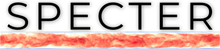

SPECTER
=======
**SPECTER** (**S**pecial **Pe**riodic **C**ontinuation **T**urbulence Solv**er**) is a **Fortran** program (with some **C** bindings) that performs numerical integration in 3D space for a set of PDEs usually found in fluid dynamics. 

A pseudo-spectral method is used to compute spatial derivatives, coupled with an adjustable order Runge-Kutta time stepping. When non-periodic directions are specified, **SPECTER** utilizes FC-Gram continuations to compute Fourier transforms with minimal overhead and considerable accuracy. At its present state, **SPECTER** has support for a single non-periodic direction. Support for two or more non-periodic directions is planned.

**SPECTER** is programmed to scale. It can be run in your workstation as well as in top notch supercomputers. With this in mind, the code is parallelized with **MPI**.

This fork organizes **SPECTER** as the `new_paradigm` branch of **GHOST**: the solver, the initial conditions, the forcing and the time stepper are classes chosen at run time from the input file. For now, only the hydrodynamic solver (`HD`) is available.

----
Getting SPECTER
---------------
If you have git installed in your system, you can run 
```
git clone https://github.com/mfontanaar/SPECTER
```
Alternatively, you can fetch it using `curl` or `wget` with
```
curl/wget https://github.com/mfontanaar/SPECTER
```
If you are using a web browser, you can also get it via [this link](https://github.com/mfontanaar/SPECTER/archive/master.zip).

Prequisites
-----------
**SPECTER** needs **Fortran** and **C** compilers to be present in the system, and an installation of both **FFTW** 3.x and an **MPI** flavor (`mpich`, `openmpi`, etc.) is required.

Compiling
---------
**SPECTER** is compiled with CMake, out of the source tree. The grid, the FC-Gram continuation and the floating-point precision are set at compile time, in `UserConfig.cmake` or with `-D` options; for instance
```
mkdir build && cd build
cmake .. -DFFTW3_ROOT=/path/to/fftw -DNZ=128 -DPRECISION=SINGLE
make
```
The output binary is placed in the `bin/` directory, and named like the solver (`HD`, the only one available). See `src/README.md` for all the options.

Running SPECTER
---------------
After the compilation, a binary file with the name of the selected solver is placed in `bin/` directory. In that same directory, a file named `parameter.inp` can be found, where you can specify several important parameters like magnitude of the time step, the number of steps to perform, how often to save output information. Physical parameters like the forcing amplitude, the mmagnitude of the initial condition or the viscosity are also specified in `bin/parameter.inp/`. A full list of the parameters with their description can be found in the same file, as well as in `src/README.md`. After setting up `parameters.inp` you can run the code with
```
./SOLVER
```
If you are running **SPECTER** in a cluster that uses a queuing system like `TORQUE` or `Slurm` you must follow the instructions provided by the cluster administrator to add `SOLVER` to the queue.

Forcing and initial conditions
------------------------------
The initial velocity field is chosen at run time with the list `iclist` of the namelist `initial_conditions` in `parameter.inp` (null field, noise that satisfies no-slip, and the laminar Couette and Poiseuille profiles, see `src/ic/ic_velocity.f90` and `src/README.md`). The mechanical forcing is also chosen at run time, with the list `forces` of the namelist `forcing` (null forcing, or a uniform forcing along x, see `src/force/force_velocity.f90`).

Getting FC-Gram tables
----------------------
For non-periodic directions, **SPECTER** uses tables to compute appropriate periodic extensions. A collection of commonly employed tables can be found in the `tables/` directory. However, a supplementary **Fortran** program to generate these tables is available at [https://github.com/mfontanaar/fctables](https://github.com/mfontanaar/fctables).

More information
----------------
To get the best out of **SPECTER** we recommend reading the information provided in `src/README.md` for a detailed explanation of each compilation and runtime parameter.

References
----------
- Fontana, M., Bruno, O. P., Mininni P. D. & Dmitruk P.; *Fourier continuation method for incompressible fluids with boundaries*. Comp. Phys. Comm. 256, 107482 (2020).DOI: [10.1016/j.cpc.2020.107482](https://doi.org/10.1016/j.cpc.2020.107482).
- Fontana M, Mininni PD, Bruno OP & Dmitruk P; *Vector potential-based MHD solver for non-periodic flows using Fourier continuation expansions*. Comp. Phys. Comm. 275, 108304 (2022). DOI: [10.1016/j.cpc.2022.108304](https://doi.org/10.1016/j.cpc.2022.108304).
- Bruno, O. P. & Lyon, M: *High-order unconditionally stable FC-AD solvers for general smooth domains I. Basic elements*. Jour. Comp. Phys.  229, (2010). DOI: [10.1016/j.jcp.2009.11.020](https://doi.org/10.1016/j.jcp.2009.11.020).
- Mininni P. D., Rosenberg D. L., Reddy R. & Pouquet A.; *A hybrid MPI–OpenMP scheme for scalable parallel pseudospectral computations for fluid turbulence*. P. Comp. 37, 123 (2011). DOI: [10.1016/j.parco.2011.05.004](https://doi.org/10.1016/j.parco.2011.05.004).
- Rosenberg D. L., Mininni P. D., Reddy R. & Pouquet A.; *GPU parallelization of a hybrid pseudospectral fluid turbulence framework using CUDA*.  Atmosphere 11, 178 (2020). DOI: [10.3390/atmos11020178](https://doi.org/10.3390/atmos11020178).

Citation
--------
If you use **SPECTER** for a publication, we kindly ask you to cite the following article: **Fontana, M., Bruno, O. P., Mininni P. D. & Dmitruk P.; *Fourier continuation method for incompressible fluids with boundaries*. Comp. Phys. Comm. 256, 107482 (2020).DOI: [10.1016/j.cpc.2020.107482](https://doi.org/10.1016/j.cpc.2020.107482)**.

Depending on the solver, we also ask you to consider citing:
- `MHD`: **Fontana M, Mininni PD, Bruno OP & Dmitruk P; *Vector potential-based MHD solver for non-periodic flows using Fourier continuation expansions*. Comp. Phys. Comm. 275, 108304 (2022). DOI: [10.1016/j.cpc.2022.108304](https://doi.org/10.1016/j.cpc.2022.108304)**.

---
### Authors
- Mauro Fontana - Physics Department at University of Buenos Aires.
- Pablo D. Mininni - Physics Department at University of Buenos Aires.
